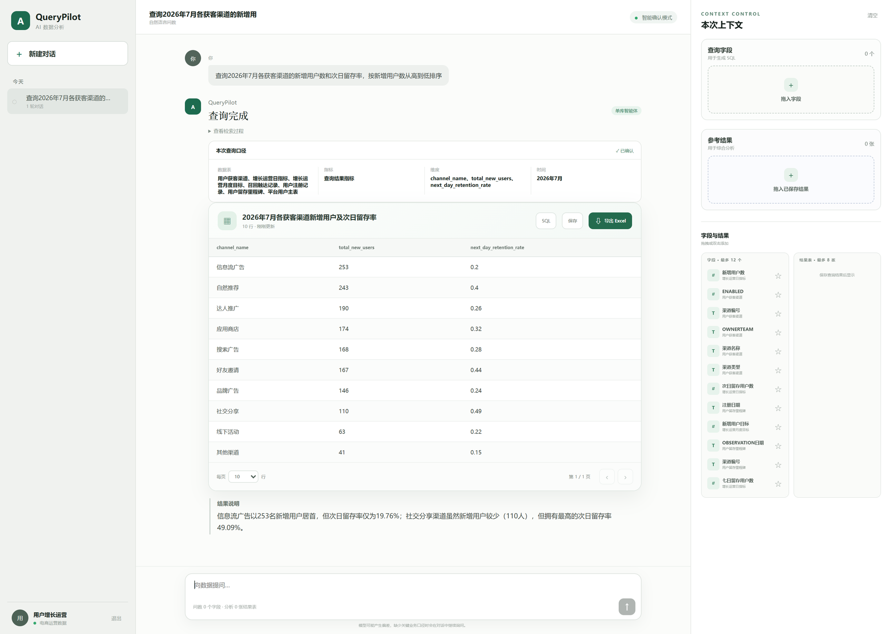

# QueryPilot

**面向短视频运营的自然语言问数工作台** · FastAPI + LangGraph + MCP + DuckDB + Vue 3

<p>
  
  
  
  
  
  
  
</p>

<p align="center">
  
</p>

<p align="center">
  <sub>真实请求：问「2026 年 7 月各获客渠道的新增用户数和次日留存率」→ 自动召回字段、生成 SQL、DuckDB 执行，并给出「信息流广告新增最多但次日留存仅 19.76%，社交分享留存最高 49.09%」的结论</sub>
</p>

---

## 为什么不是"套一层 LLM 生成 SQL"

运营同学要的是**能对得上的数字**，不是看起来像 SQL 的字符串。一个 41 张表的分析库，纯靠模型猜表和字段，失败方式是隐性的：SQL 能跑、结果是错的。

QueryPilot 把不确定性拆到三个可控环节：

| 环节 | 做法 | 解决的问题 |
|---|---|---|
| 找字段 | 字段级 Schema 索引：BM25 + Dense 双路召回 → RRF 融合 → Rerank 打分，阈值 0.55 截断，最多 20 个字段 | 表多字段多，模型不该靠猜知道 `day1_retained_users` 存在 |
| 定口径 | 检索结果构建成 Schema 图（表 / 字段 / 关系），先把「数据表、指标、维度、时间」摊开确认再执行 | 同一个"新增用户"，口径不同结果差一倍 |
| 敢说不知道 | LangGraph 里带 `interrupt` 的澄清节点，命中歧义就停下来让人选，而不是硬猜 | 猜错的成本远高于问一句 |

## 核心设计

**1. 混合检索 + 结构化 Schema 图**

中文运营语料里，"拉新""获客""新增用户"是同一个东西。索引不仅存字段名，还存别名、样例值、字段画像和 `rerank_text`；Dense 负责语义、BM25 负责字面，RRF 融合后交给 `qwen3-rerank` 打分，低于阈值的字段直接丢弃——宁可少召回，不给模型塞噪音。

**2. LangGraph 工作流，节点可中断可恢复**

```
START → preprocess（上下文聚合 / 路由 / 检索词提取）
          ├─ direct_response  → END        （寒暄、能力边界）
          ├─ data_qa          → END        （口径类问答，不查库）
          └─ retrieve_schema
                └─ 澄清判断 ─┬─ human_clarification（interrupt 暂停，等人选）→ 回到检索
                             ├─ prepare_single_database → execute_single_database → END
                             └─ run_multi_database → END
```

checkpointer 按 `task_id` 存状态，所以澄清不是"再来一次"，而是从断点继续；前端拿到 `task_id` 就能续跑。

**3. MCP 工具运行时，而不是函数直调**

日期解析、日期区间推断、柱状图、饼图、数据库查询都封装成 MCP 工具（进程内传输，共 5 个），模型看到的是工具契约而不是 prompt 里的字符串约定。换传输方式（stdio / HTTP）不用改业务代码。

**4. 上下文与记忆分层**

短期会话摘要（超 12k token 触发批量压缩）、口径确认结果、已保存的字段与结果集、会话归档，四层各管一段：最近几轮保原文，更早的压成摘要，用户明确保存的进长期记忆。

**5. 权限不是装饰**

登录后拿到的 `AccessScope` 决定可查哪些表，不同角色看到的是不同子集——数据问数产品最容易漏的一环。

## 评测

评测集 430 条（用户增长 145 / 渠道投放 140 / 内容运营 145；简单 283 / 中等 132 / 复杂 15，其中 49 条为经典冒烟用例），gold SQL 与期望结果一并入库。

**gold 模式**（不调模型，验证数据集与 DuckDB 执行层）：

| 指标 | 结果 |
|---|---|
| 用例数 | 430 |
| SQL 执行成功率 | **100%** |
| 结果正确率 | **100%** |
| 平均执行耗时 | 2.08 s（P95 2.56 s） |

**live 模式**（真实调用模型，基线报告见 `backend/evaluation/results/`）：

| 范围 | 用例 | Schema 召回 | Schema 准确 | SQL 执行成功率 | 结果正确率 |
|---|---:|---:|---:|---:|---:|
| 经典冒烟 | 49 | 92.99% | 16.46% | 100% | **91.84%** |
| 全量 | 430 | 95.26% | 19.44% | 99.30% | **82.56%** |

指标定义、等价 SQL 判定规则和复跑命令见 [`backend/evaluation/README.md`](backend/evaluation/README.md)。

> Schema 准确率低不是坏消息：召回 20 个字段里只有少数被 SQL 用到，说明阈值偏宽松、还有收紧空间。这个取舍写在了下面的「已知限制」里。

## 快速开始

后端（Python 3.11+）：

```bash
cd backend
python -m venv .venv
.venv/Scripts/python.exe -m pip install -r requirements.txt   # macOS/Linux: .venv/bin/python
cp .env.example .env                                          # 填入 LLM_API_KEY
.venv/Scripts/python.exe run.py
```

首次查询会自动构建字段索引（约 10 秒，结果写入 `data/schema_store.json`）。也可以预建：

```bash
.venv/Scripts/python.exe scripts/prepare_schema_index.py
```

前端（Node 20+）：

```bash
cd frontend
npm install
npm run dev     # http://127.0.0.1:5173
```

接口文档：`http://127.0.0.1:8000/docs`

模型侧默认走阿里云百炼的 OpenAI 兼容接口：`qwen3.7-plus`（对话）、`text-embedding-v4`（1024 维）、`qwen3-rerank`（重排）。三者都可在 `.env` 里替换为任意兼容实现。

演示账号（Mock 登录，仅本地学习用）：

| 账号 | 密码 | 角色 |
|---|---|---|
| `admin` | `admin123` | 系统管理员 |
| `growth` | `growth123` | 用户增长运营 |
| `channel` | `channel123` | 渠道投放运营 |
| `content` | `content123` | 内容运营 |

## 数据

41 张 CSV 表 / 72.3 万行 / 51 MB，覆盖短视频运营三条主线：

- **用户增长**：注册、激活、日活、留存、流失、生命周期快照、设备、标签
- **渠道投放**：渠道、广告账户 / 计划 / 素材、日投放统计、归因、转化事件、渠道目标、预算调整、召回活动
- **内容运营**：内容主表、分类、标签、日指标、审核、创作者及其日指标、热门话题、播放与互动

数据由 `backend/scripts/generate_short_video_ops_data.py` 生成，Schema 由 `generate_short_video_ops_schema.py` 维护，可用 `validate_short_video_ops.py` 校验一致性。

## 目录结构

```
backend/
├── app/
│   ├── api/routes.py            # 21 个接口：登录、Schema、问数、澄清、记忆、配置
│   ├── workflows/query_graph.py # LangGraph 拓扑与路由
│   ├── retrieval/               # BM25 + Dense + RRF + Rerank 与 Schema 图
│   ├── querying/                # 单库智能体、DuckDB 引擎、结果生成
│   ├── mcp_runtime/             # MCP Server/Client 与 5 个工具
│   ├── services/                # 问数服务、短期记忆、会话上下文、归档
│   ├── security/                # 登录鉴权与表级访问范围
│   └── skills/                  # data_qa / database_query（SKILL.md + config.json）
├── data/databases/short_video_ops/   # 41 张 CSV + manifest + schema
├── evaluation/                  # 430 条用例、评测脚本、基线报告
├── scripts/                     # 数据生成、索引构建、数据校验
└── tests/                       # 17 个单元测试
frontend/                        # Vue 3 + TypeScript：问数、结果表、图表、报告
```

规模：后端约 4,700 行 Python，前端约 2,100 行 Vue / TS。

## 设计取舍

**为什么做字段级索引，而不是把整张 schema 塞给模型**
41 张表全塞进 prompt 会超长且淹没重点。字段级召回把上下文压到 20 个字段，代价是要维护别名与画像——但这部分可以脚本化，而 prompt 塞爆没法自动化。

**为什么要"澄清"这个节点**
问数场景的失败大多不是语法错误，而是口径错。把歧义暴露成一次点击，比生成一个自信的错误数字便宜得多。

**为什么保留 gold 模式**
gold 不调模型，跑一遍十几分钟，能稳定区分"数据集 / 执行层坏了"和"模型答得不好"。没有这一层，live 掉分时根本不知道从哪查起。

**为什么用 MCP 而不是直接调函数**
工具契约（入参 schema、返回结构）由协议描述，模型侧与实现侧解耦；以后接外部数据源（数据库、BI 平台）不用改编排层。

## 已知限制

- **单库为主**：多库路由已接通（`run_multi_database`），但 41 张表同属一个库，多库路径缺少真实数据验证。
- **复杂跨表问题仍会失败**：实测「各渠道花费 vs 新增用户的获客成本」时，模型把 `spend` 认成了 `growth_daily_metrics` 的列（实际在 `channel_targets` / `ad_daily_stats`），DuckDB 直接报 Binder Error。这类跨表口径需要更强的 Schema 关系约束。
- **Schema 准确率偏低**：见评测表，召回字段多于实际使用，说明可以进一步收紧阈值或引入字段使用频次先验。
- **Mock 登录**：账号密码硬编码在代码里，仅用于本地演示，不是可上线的鉴权方案。

## 文档

| 想了解 | 看这里 |
|---|---|
| 评测指标与复跑方式 | [`backend/evaluation/README.md`](backend/evaluation/README.md) |
| 字段索引构建逻辑 | [`backend/app/retrieval/service.py`](backend/app/retrieval/service.py) |
| 工作流拓扑 | [`backend/app/workflows/query_graph.py`](backend/app/workflows/query_graph.py) |
| 问数技能与口径约束 | [`backend/app/skills/database_query/SKILL.md`](backend/app/skills/database_query/SKILL.md) |
